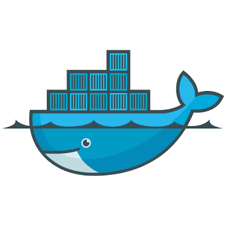

# Chapitre 06 — Gérer les conteneurs avec Docker

> **Objectif :** apprendre à gérer des conteneurs avec Docker, construire des images avec un `Dockerfile`, comprendre les layers et le cache de build, configurer les ports, les volumes, les variables d'environnement et les réseaux, et déployer des applications multi-conteneurs.

<p align="center">
  
</p>

---

## 0. Introduction à Docker

Docker est une plateforme permettant de construire des images et d'exécuter des conteneurs.

Les commandes Docker sont très proches de celles de Podman. Les principales opérations sont similaires :

| Opération | Docker | Podman |
|---|---|---|
| Lancer un conteneur | `docker run` | `podman run` |
| Lister les conteneurs | `docker ps` | `podman ps` |
| Arrêter un conteneur | `docker stop` | `podman stop` |
| Construire une image | `docker build` | `podman build` |
| Copier des fichiers | `docker cp` | `podman cp` |
| Gérer les réseaux | `docker network` | `podman network` |
| Gérer les volumes | `docker volume` | `podman volume` |

La principale différence d'architecture est que Docker Engine utilise généralement un service central, `dockerd`, tandis que Podman peut fonctionner sans démon central permanent. (voir chapitre 2)


Dans ce chapitre, nous nous concentrons sur l'utilisation pratique de Docker et sur certains mécanismes internes de construction des images.

---

## 1. Construire une image avec un `Dockerfile`

| Élément | Docker | Podman |
|---|---|---|
| Fichier de construction par défaut | `Dockerfile` | `Containerfile` |
| Autre nom accepté | `Containerfile` | `Dockerfile` |
| Commande de construction | `docker build -t myapp .` | `podman build -t myapp .` |
| Instructions | `FROM`, `RUN`, `COPY`, `CMD`, `ENTRYPOINT`, etc. | Les mêmes instructions |
| Syntaxe | Syntaxe Dockerfile | Syntaxe compatible Dockerfile |

> **À retenir :** Docker utilise `Dockerfile` par convention, tandis que Podman utilise `Containerfile`. Les deux outils acceptent les deux noms et utilisent essentiellement la même syntaxe de construction.

### 1.1 Différence entre `CMD` et `ENTRYPOINT`

Ces deux instructions déterminent ce qui sera exécuté lorsque l'on crée un conteneur à partir d'une image.

La différence essentielle est la suivante :

- `CMD` définit une commande par défaut ou des arguments par défaut.
- `ENTRYPOINT` définit le programme principal que le conteneur doit exécuter.

#### 1.1.1 Utiliser `CMD` seul

Exemple :

```dockerfile
FROM alpine:3.22

CMD ["echo", "Hello Docker"]
```

Construire l'image :

```bash
docker build -t hello-cmd .
```

Lancer le conteneur :

```bash
docker run --rm hello-cmd
```

Résultat :

```text
Hello Docker
```

On peut remplacer la commande par défaut :

```bash
docker run --rm hello-cmd echo "Hello Podman"
```

Résultat :

```text
Hello Podman
```

Ici, `CMD` est adapté parce que l'utilisateur peut facilement remplacer la commande lors du lancement.

#### 1.1.2 Utiliser `ENTRYPOINT` seul

Exemple :

```dockerfile
FROM alpine:3.22

ENTRYPOINT ["echo"]
```

Construire :

```bash
docker build -t echo-tool .
```

Lancer :

```bash
docker run --rm echo-tool "Hello Docker"
```

Résultat :

```text
Hello Docker
```

Dans ce cas, `echo` est le programme principal. Les arguments fournis après le nom de l'image sont transmis à ce programme.

Par exemple :

```bash
docker run --rm echo-tool "Hello Students"
```

Résultat :

```text
Hello Students
```

### 1.1.3 Utiliser `ENTRYPOINT` et `CMD` ensemble

C'est un modèle très utile pour créer une image qui se comporte comme un outil exécutable.

```dockerfile
FROM alpine:3.22

ENTRYPOINT ["echo"]

CMD ["Hello Docker"]
```

Construire :

```bash
docker build -t echo-tool .
```

Lancer sans argument :

```bash
docker run --rm echo-tool
```

Résultat :

```text
Hello Docker
```

Lancer avec un autre argument :

```bash
docker run --rm echo-tool "Hello Students"
```

Résultat :

```text
Hello Students
```

Dans cet exemple :

- `ENTRYPOINT` fixe le programme `echo`.
- `CMD` fournit l'argument par défaut.
- Les arguments de `docker run` remplacent les arguments définis par `CMD`, sans supprimer l'`ENTRYPOINT` au format exec.

### 1.1.4 Comparaison

| Situation | Comportement |
|---|---|
| `CMD` seul | La commande par défaut peut être remplacée |
| `ENTRYPOINT` seul | Le programme principal reste fixé ; les arguments peuvent être ajoutés |
| `ENTRYPOINT` + `CMD` | Programme principal fixe avec arguments par défaut modifiables |


## 2. Comprendre les layers d'une image Docker

### 2.1 Qu'est-ce qu'un layer ?

Une image Docker est constituée de plusieurs couches, appelées *layers*.

Chaque couche représente généralement des modifications du système de fichiers apportées pendant la construction de l'image. Docker réutilise les couches communes entre les images pour éviter de stocker plusieurs fois les mêmes données.

Prenons le Dockerfile suivant :

```dockerfile
FROM alpine:3.22

RUN apk add --no-cache curl

WORKDIR /app

COPY app.sh /app/app.sh

CMD ["sh", "/app/app.sh"]
```

On peut représenter conceptuellement les étapes ainsi :

```text
┌──────────────────────────────────┐
│ Configuration par défaut : CMD   │
├──────────────────────────────────┤
│ COPY app.sh /app/app.sh          │
├──────────────────────────────────┤
│ WORKDIR /app                     │
├──────────────────────────────────┤
│ RUN apk add --no-cache curl      │
├──────────────────────────────────┤
│ Image de base : alpine:3.22      │
└──────────────────────────────────┘
```

Ce schéma représente les étapes de construction, et non une correspondance exacte entre chaque instruction et un layer physique.

Les instructions comme `RUN`, `COPY` et `ADD` créent normalement des couches de système de fichiers. D'autres instructions, telles que `CMD`, `ENV` et `WORKDIR`, modifient la configuration de l'image sans nécessairement créer une nouvelle couche de fichiers.

### 2.2 Pourquoi utiliser des layers ?

Les layers apportent plusieurs avantages :

- **Réutilisation :** plusieurs images peuvent partager les mêmes couches.
- **Économie d'espace :** les données communes ne doivent pas être dupliquées inutilement.
- **Rapidité :** Docker peut réutiliser les résultats d'étapes déjà construites.
- **Distribution :** les couches manquantes peuvent être téléchargées depuis un registre, sans récupérer à nouveau toutes les couches communes.

Par exemple, si plusieurs images utilisent `alpine:3.22`, elles peuvent partager les couches de cette image de base.

### 2.3 Comment les layers sont-ils stockés ?

Docker utilise **containerd** pour gérer notamment les images et les conteneurs.

Les images sont stockées sous forme de **blobs**, c'est-à-dire des objets contenant les données des couches (*layers*) et les métadonnées associées.

- **Blobs :** stockent le contenu des layers de l'image.
- **Content store de containerd :** conserve ces blobs.
- **Snapshots :** permettent de combiner les layers pour former le système de fichiers utilisé par le conteneur.
- **OverlayFS :** permet, sur Linux, de superposer les couches et d'ajouter une couche inscriptible au conteneur.

Pour examiner les informations de stockage :

```bash
docker info
```

Pour afficher les informations d'une image :

```bash
docker image inspect custom-nginx:1.0
```

Pour consulter l'historique des couches :

```bash
docker image history custom-nginx:1.0
```

> **À retenir :** les blobs stockent le contenu des couches, tandis que les snapshots permettent de les utiliser comme un système de fichiers. `docker image history` affiche l'historique de l'image, pas directement les blobs physiques.


## 3. Comprendre le cache de build

### 3.1 Qu'est-ce que le cache ?

Lorsque Docker construit une image, il examine les instructions du `Dockerfile` dans l'ordre.

Si une instruction correspond à un résultat de construction réutilisable, Docker peut employer le cache au lieu de réexécuter cette étape.

Exemple :

```dockerfile
FROM alpine:3.22

RUN apk add --no-cache curl

WORKDIR /app

COPY app.sh /app/app.sh

CMD ["sh", "/app/app.sh"]
```

Premier build :

```bash
docker build -t myapp:1.0 .
```

Lors de ce premier build, Docker doit exécuter les étapes nécessaires.

Deuxième build, sans modification :

```bash
docker build -t myapp:1.0 .
```

Docker peut réutiliser les résultats précédents.

Dans la sortie du build, on peut notamment voir des indications telles que `CACHED` lorsque BuildKit réutilise une étape.
> **Remarque :** BuildKit est le moteur de construction utilisé par Docker pour construire des images.

### 3.3 Pourquoi utiliser `--no-cache` ?

L'option `--no-cache` demande à Docker de ne pas réutiliser le cache des étapes de construction.

```bash
docker build --no-cache -t myapp:1.0 .
```

Elle est utile notamment lorsque l'on veut :

- forcer la réexécution des instructions de build ;
- éviter de réutiliser un résultat d'installation mis en cache ;
- tester si le Dockerfile fonctionne sans les résultats des builds précédents ;
- effectuer un build de diagnostic.


### 3.4 Comment optimiser le cache ?

Il est préférable de placer les instructions qui changent rarement avant celles qui changent fréquemment.

Exemple :

```dockerfile
FROM node:22-alpine

WORKDIR /app

COPY package.json package-lock.json ./

RUN npm ci

COPY . .

CMD ["npm", "start"]
```

Pourquoi cet ordre ?

1. L'image de base change rarement.
2. Les fichiers de dépendances changent moins souvent que le code source.
3. Les dépendances sont réinstallées seulement lorsque les fichiers concernés changent ou que le cache est invalidé.
4. Le code source est copié ensuite.

Si l'on modifie uniquement le code source, Docker peut conserver le résultat de `npm ci`.

Pour éviter d'envoyer des fichiers inutiles dans le contexte de build, ajouter un fichier `.dockerignore`, par exemple :

```text
.git
.env
*.log
```

Cela réduit la quantité de données envoyées au moteur de construction et évite d'inclure inutilement certains fichiers.

--- 
## 4. le build Multi-stage
Le Multi-Stage Build est une technique Docker qui permet d'utiliser plusieurs étapes dans un même Dockerfile. On prépare l'application dans une première étape, puis on crée une image finale qui contient uniquement les éléments nécessaires à son exécution.
```bash
# Étape 1 : préparer les dépendances
FROM python:3.12 AS builder

WORKDIR /app
COPY requirements.txt .
RUN pip install --no-cache-dir --prefix=/install -r requirements.txt

# Étape 2 : image finale
FROM python:3.12-slim

WORKDIR /app
COPY --from=builder /install /usr/local
COPY app.py .

CMD ["python", "app.py"]
```

##### Comment ça fonctionne ?
`Étape 1: Builder`
L'image python:3.12 sert à installer les dépendances définies dans requirements.txt. Elles sont placées dans le répertoire /install.
`Étape 2: Image finale`
L'image python:3.12-slim sert à exécuter l'application. La commande COPY --from=builder récupère les dépendances depuis la première étape, puis COPY app.py . ajoute le code de l'application.

##### Pourquoi utiliser cette technique ?
Le multi-stage build permet de séparer la préparation de l'application de son exécution et d'éviter d'inclure dans l'image finale des fichiers ou des outils qui ne sont pas nécessaires.

> **À retenir** : COPY --from=builder permet de copier uniquement les fichiers nécessaires depuis une étape précédente vers l'image finale.

--- 
## 5. Conclusion : comment optimiser alors une image Docker ?

Pour obtenir une image Docker légère, appliquez les bonnes pratiques suivantes :

1. **Choisir une image de base légère :** privilégier une image adaptée à l'application, comme `python:3.12-slim`, plutôt qu'une image complète si ses composants supplémentaires ne sont pas nécessaires.

2. **Créer un fichier `.dockerignore` :** exclure du contexte de construction les fichiers inutiles, tels que `.git`, `.venv`, `__pycache__`, les fichiers temporaires et les secrets comme `.env` lorsqu'ils ne sont pas nécessaires au build.

3. **Optimiser l'ordre des instructions :** copier d'abord les fichiers de dépendances, installer les dépendances, puis copier le code source. Ainsi, une modification du code ne provoque pas inutilement la réinstallation des dépendances.

4. **Utiliser le cache de construction :** laisser Docker réutiliser les étapes inchangées pour accélérer les constructions successives.

5. **Utiliser le Multi-Stage Build :** séparer les étapes de compilation ou de préparation de l'image finale pour ne conserver que les fichiers et dépendances nécessaires à l'exécution.

6. **Limiter les dépendances et les privilèges :** installer uniquement les paquets nécessaires et exécuter l'application avec un utilisateur non privilégié lorsque cela est possible.


**Objectif final :** construire une image Docker aussi légère que possible, sans supprimer les composants nécessaires, tout en conservant une application fonctionnelle et  maintenable.

## 6. Questions de compréhension

1. Quelle est la différence entre une image et un conteneur ?
2. Quel est le rôle de `FROM` dans un Dockerfile ?
3. Quelle est la différence entre `RUN` et `CMD` ?
4. Quel est le rôle de `ENTRYPOINT` ?
5. Quelle est la différence entre `CMD` et `ENTRYPOINT` ?
6. Pourquoi associe-t-on souvent `ENTRYPOINT` et `CMD` ?
7.  Qu'est-ce qu'un layer d'image ?
8. Quels sont les avantages des layers ?
9. Quel est le rôle du cache de build ?
10. Quelle est la différence entre `--no-cache` et `--pull` ?
11. Comment organiser un Dockerfile pour réutiliser davantage le cache ?
12. À quoi sert `.dockerignore` ?
13. Comment examiner l'historique d'une image ?
14. Quelle commande permet de consulter les logs d'un conteneur ?
15. Pourquoi les données d'une base de données doivent-elles être conservées dans un stockage persistant ?

---

## Test — Gérer les conteneurs avec Docker


